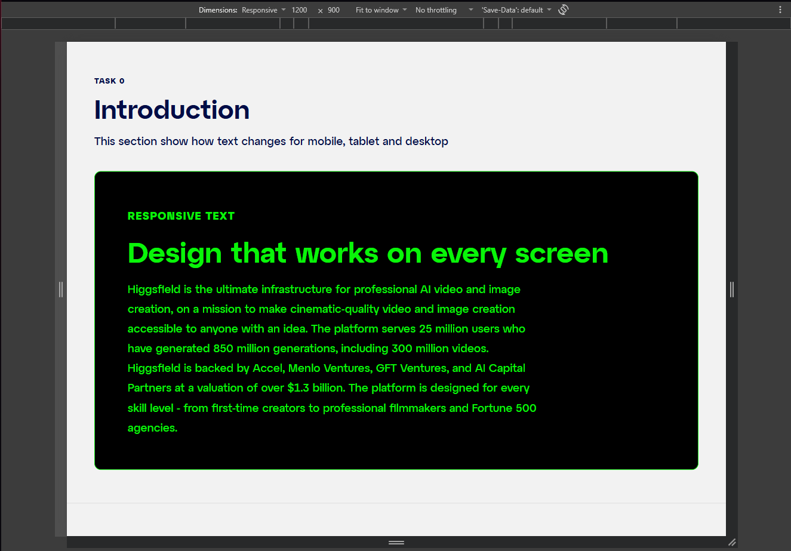
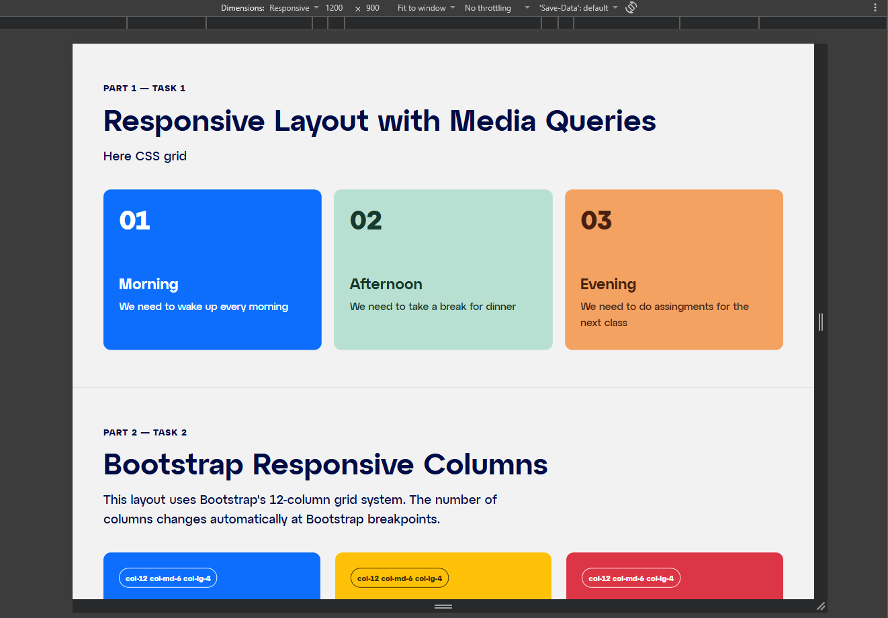
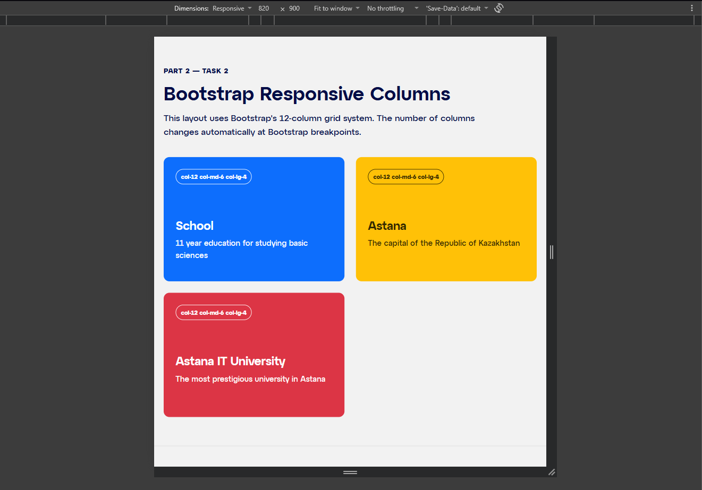
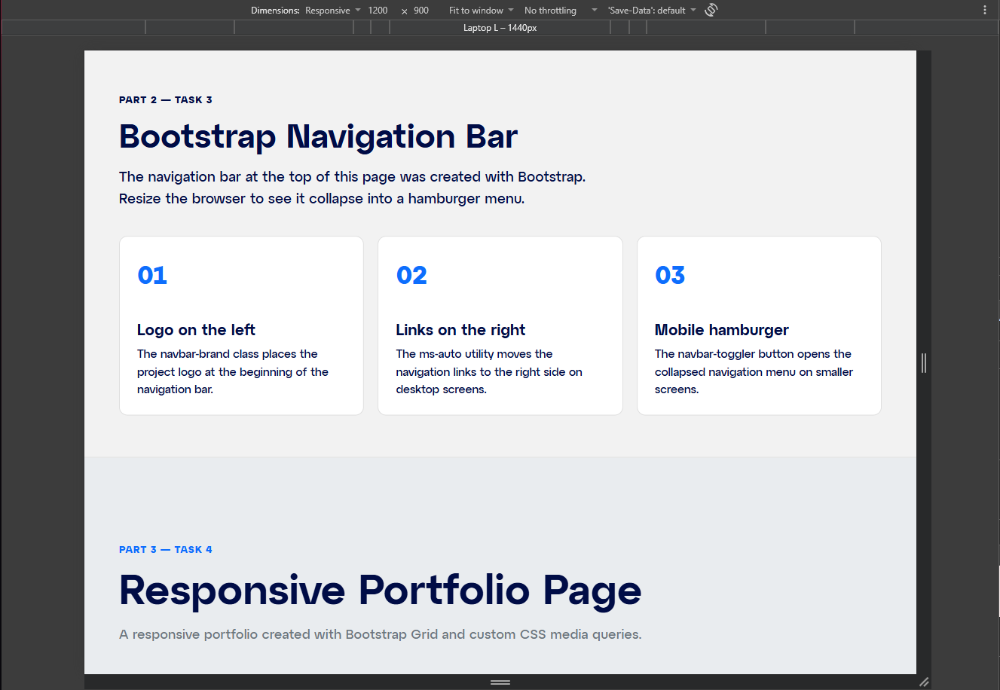
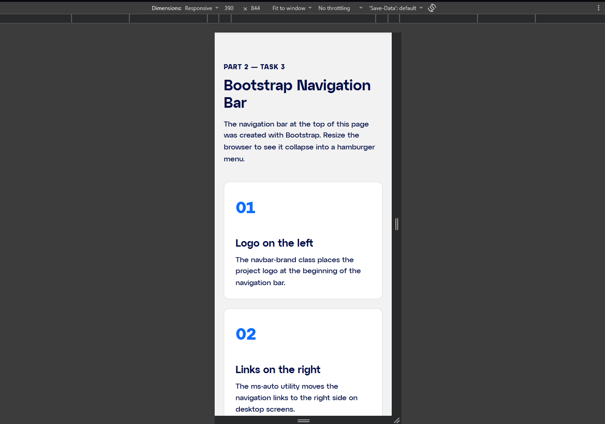
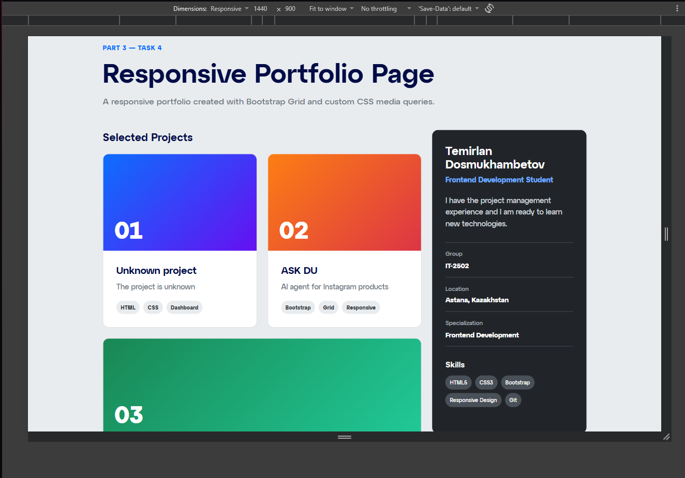
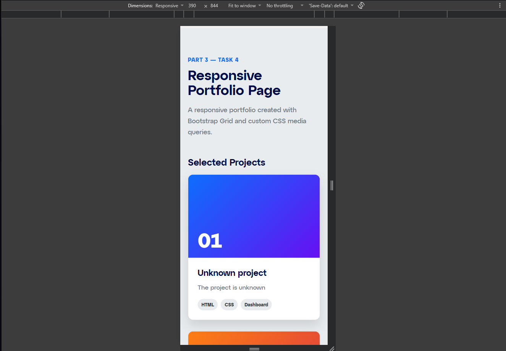

# Assignment 3 — Responsive Web Design

## Student Information

- **Name:** Temirlan Dosmukhambetov
- **Group:** IT-2502
- **Course:** Frontend Development
- **Assignment:** Responsive Web Design with Media Queries and Bootstrap Grid

## Project Overview

This project demonstrates the main principles of responsive web design.

All assignment tasks are presented on a single webpage. The layout adapts to mobile, tablet, and desktop screen sizes using custom CSS media queries and Bootstrap 5.

The project includes responsive typography, a CSS Grid layout, the Bootstrap 12-column grid system, a collapsible Bootstrap navigation bar, and a complete responsive portfolio section.

## Technologies Used

- HTML5
- CSS3
- CSS Media Queries
- CSS Grid
- Bootstrap 5.3
- Bootstrap Grid System
- Bootstrap Navbar
- Git and GitHub

## Responsive Breakpoints

The project uses a mobile-first approach.

| Device | Screen width | Layout behavior |
|---|---:|---|
| Mobile | Below 768px | One-column layouts and compact typography |
| Tablet | From 768px | Two-column layouts and medium typography |
| Desktop | From 992px | Three-column layouts and larger typography |

---

## Part 1 — Media Queries

### Task 0 — Responsive Typography

This section demonstrates responsive typography using custom CSS media queries.

The sizes of headings, paragraphs, spacing, and container padding change depending on the screen width:

- Mobile devices use compact font sizes.
- Tablets use medium font sizes.
- Desktop screens use larger typography and spacing.

The implementation follows a mobile-first approach. The base styles are written for mobile devices, while `min-width: 768px` and `min-width: 992px` media queries provide tablet and desktop styles.



### Task 1 — Responsive Layout with Media Queries

This section contains three responsive content boxes.

The layout was created with CSS Grid and custom media queries without using the Bootstrap Grid system.

Layout behavior:

- On mobile screens, the boxes are stacked vertically.
- On tablet screens, two boxes appear in the first row and the third box moves to the second row.
- On desktop screens, all three boxes appear in one row.

The number of columns is controlled using `grid-template-columns`.



---

## Part 2 — Bootstrap Grid System

### Task 2 — Bootstrap Responsive Columns

This section demonstrates Bootstrap's 12-column grid system.

Each column uses the following responsive classes:

```html
col-12 col-md-6 col-lg-4
```

These classes provide the following behavior:

- `col-12` makes each element use the full row on mobile devices.
- `col-md-6` makes each element use half of the row on tablets.
- `col-lg-4` makes each element use one third of the row on desktop screens.

As a result, the section displays one, two, or three columns depending on the viewport width.



### Task 3 — Bootstrap Navigation Bar

The navigation bar was created using Bootstrap components.

It contains:

- A project logo on the left.
- Navigation links on the right.
- Links to every assignment section.
- A hamburger button on smaller screens.
- A collapsible mobile navigation menu.

The `navbar-expand-lg` class keeps the navigation collapsed below the `lg` breakpoint. Bootstrap JavaScript controls the opening and closing behavior of the hamburger menu.

#### Desktop navigation



#### Mobile navigation



---

## Part 3 — Combined Project

### Task 4 — Responsive Portfolio Page

The final portfolio combines Bootstrap components and custom CSS media queries.

The portfolio contains:

- A Bootstrap navigation bar.
- A responsive introduction section.
- A project card area.
- A personal information sidebar.
- A skills list.
- Contact and GitHub information.
- A footer across the bottom.

Bootstrap Grid divides the main section into two parts:

```html
col-12 col-lg-8
col-12 col-lg-4
```

On mobile and tablet screens, the project area and sidebar are stacked vertically.

On desktop screens:

- The project area occupies 8 of 12 Bootstrap columns.
- The sidebar occupies 4 of 12 Bootstrap columns.

Custom media queries adjust typography, spacing, layout details, and element visibility at different screen sizes.

#### Desktop portfolio



#### Mobile portfolio



---

## Work Process

I completed the assignment in several stages.

1. I created the basic semantic HTML structure and added the viewport meta tag.
2. I connected Bootstrap 5 CSS and JavaScript through a CDN.
3. I created responsive typography using custom CSS media queries.
4. I built a responsive three-box layout using CSS Grid without Bootstrap.
5. I recreated a similar responsive layout using Bootstrap's 12-column grid system.
6. I added a Bootstrap navigation bar with a collapsible mobile menu.
7. I created a responsive portfolio with project cards and a personal information sidebar.
8. I tested the webpage at mobile, tablet, and desktop viewport sizes.
9. I corrected layout, spacing, and text problems found during testing.
10. I created screenshots for every assignment task and documented the results in this README.

## Project Structure

```text
assignment3-wb/
├── index.html
├── style.css
├── README.md
└── screenshots/
    ├── task0.png
    ├── task1.png
    ├── task2.png
    ├── task3-desktop.png
    ├── task3-mobile.png
    ├── task4-desktop.png
    └── task4-mobile.png
```

## How to Run the Project

1. Download or clone the repository.
2. Open the project folder.
3. Open `index.html` in a web browser.

The project does not require package installation or a build process because Bootstrap is connected through a CDN.

## Responsive Testing

The webpage was tested using the browser's responsive device mode at the following viewport widths:

- `390px` for mobile devices
- `768px` for tablets
- `1200px` for desktop screens

During testing, I checked:

- Typography scaling
- Column wrapping
- Bootstrap breakpoints
- Navigation collapse behavior
- Hamburger menu functionality
- Project card alignment
- Sidebar positioning
- Element visibility
- Horizontal overflow

## Conclusion

This assignment helped me understand the difference between custom CSS media queries and Bootstrap's responsive grid system.

Custom media queries provide detailed control over typography, spacing, and layout behavior. Bootstrap provides predefined breakpoints, responsive grid classes, and interactive components that make development faster.

Combining both approaches makes it possible to build responsive interfaces that are structured, readable, and usable across different screen sizes.